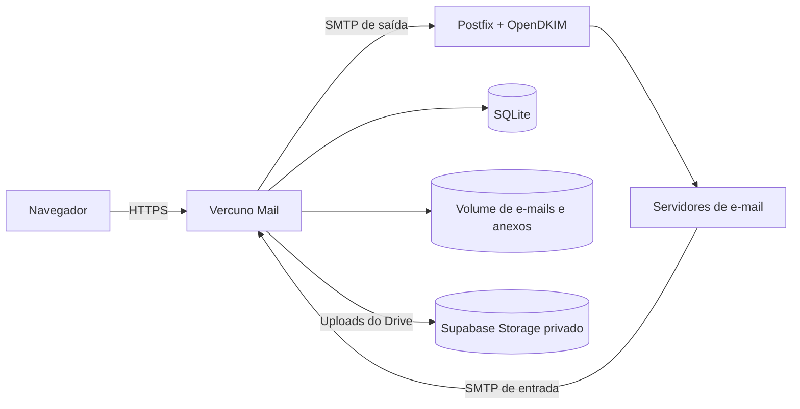

<div align="center">
  <picture>
    <source media="(prefers-color-scheme: dark)" srcset="docs/assets/vercuno-dark.png">
    
  </picture>

  <h1>Vercuno Mail</h1>

  <p>Webmail, agenda e arquivos da equipe em uma instalação que você hospeda.</p>

  <a href="LICENSE"></a>
  <a href="docs/self-hosting.md"></a>
  <a href="docs/localization.md"></a>

  <p>
    <a href="https://mail.vercuno.com.br/login"><strong>Abrir o webmail</strong></a> ·
    <a href="#instala%C3%A7%C3%A3o-com-docker">Instalar</a> ·
    <a href="#arquitetura">Arquitetura</a> ·
    <a href="#documenta%C3%A7%C3%A3o">Documentação</a>
  </p>
</div>

---

O **Vercuno Mail** é a edição autohospedada do [Mailflare](https://github.com/hieunc229/mailflare) mantida pela Vercuno. A equipe entra com endereços do próprio domínio, organiza os e-mails em caixas pessoais e pode usar agenda e Drive pelo mesmo navegador.

## O que você pode fazer

| Área | Recursos |
| --- | --- |
| **E-mail** | Usar caixas pessoais no domínio da equipe, importar mensagens e configurar regras de roteamento. |
| **Administração** | Gerenciar contas e caixas pelo painel, acompanhar MX, SPF, DKIM e DMARC e editar o nome e o ícone da instalação. |
| **Drive** | Criar pastas, enviar arquivos em partes com retomada e compartilhar itens com outras contas. |
| **Agenda e agendamento** | Criar eventos com recorrência e compartilhar um link de agendamento. |
| **Integrações** | Usar webhooks, chaves de API e conexão opcional com ferramentas via MCP. |

## Arquitetura

Na instalação da Vercuno, o Docker executa o webmail e seu listener SMTP na VPS. O Postfix envia as mensagens, com assinatura do OpenDKIM. Os uploads do Drive usam um bucket privado no Supabase Storage da mesma VPS.



As caixas pessoais e a edição da marca estão disponíveis na edição autohospedada. A listagem administrativa de caixas exibe seus endereços e estados. O acesso às mensagens pessoais exige a conta titular.

## Instalação com Docker

Você precisa de Docker com Compose, um domínio para o e-mail e um servidor SMTP de saída. O Compose deste repositório compila a edição Vercuno e usa SQLite e armazenamento local por padrão.

```bash
git clone https://github.com/RafaelADSdev/VercunoMail.git
cd VercunoMail
cp .env.docker.example .env.docker

# Ajuste .env.docker para usar seu domínio e seu SMTP.
docker compose up -d --build
docker compose logs -f mailflare
```

1. Configure `APP_URL` com a URL HTTPS pública, `MAIL_HOSTNAME` com o host SMTP e `SMTP_URL` com o servidor de saída.
2. Abra `/setup` na URL da instalação e crie o administrador e o domínio.
3. Configure os registros MX, SPF, DKIM e DMARC do domínio conforme a infraestrutura escolhida. O Compose publica o webmail na porta `3000` e o SMTP de entrada na `25`.
4. Preserve o volume `mailflare-data` nas atualizações. Para HTTPS, WebSocket e STARTTLS, consulte o [guia de instalação](docs/self-hosting.md).

### Drive no Supabase da própria VPS

Para guardar os uploads do Drive em um serviço S3 compatível, configure as variáveis `DRIVE_S3_*` do [exemplo de ambiente](.env.docker.example). Elas definem endpoint, bucket, região, credenciais e limite por arquivo em bytes. Use um bucket privado e uma credencial restrita a ele. Se já houver arquivos do Drive em outro armazenamento, copie os objetos preservando suas chaves antes da troca.

## Desenvolvimento

```bash
npm ci
node --test tests/b2-bucket.test.mjs tests/manual-dns-checks.test.mjs
```

Consulte [como executar sem Docker](docs/self-hosting.md#running-without-docker) para iniciar o servidor Node. Alterações no esquema precisam de migrações para os bancos suportados. [Bancos e migrações](docs/databases.md#migrations).

## Documentação

- [Instalação, SMTP e ambiente](docs/self-hosting.md)
- [Entregabilidade e autenticação de domínio](docs/deliverability.md)
- [API, webhooks e integrações](docs/api.md)
- [Importação de e-mails, agenda e Drive](docs/import.md)
- [Segurança](docs/security.md) e [solução de problemas](docs/troubleshooting.md)

## Créditos e licença

O **Vercuno Mail** é mantido pela [Vercuno](https://vercuno.com.br) e deriva do [Mailflare, de Hieu Nguyen e colaboradores](https://github.com/hieunc229/mailflare). O código é distribuído sob a [GNU AGPL-3.0](LICENSE). O código-fonte da versão em execução também está disponível no rodapé do webmail.
